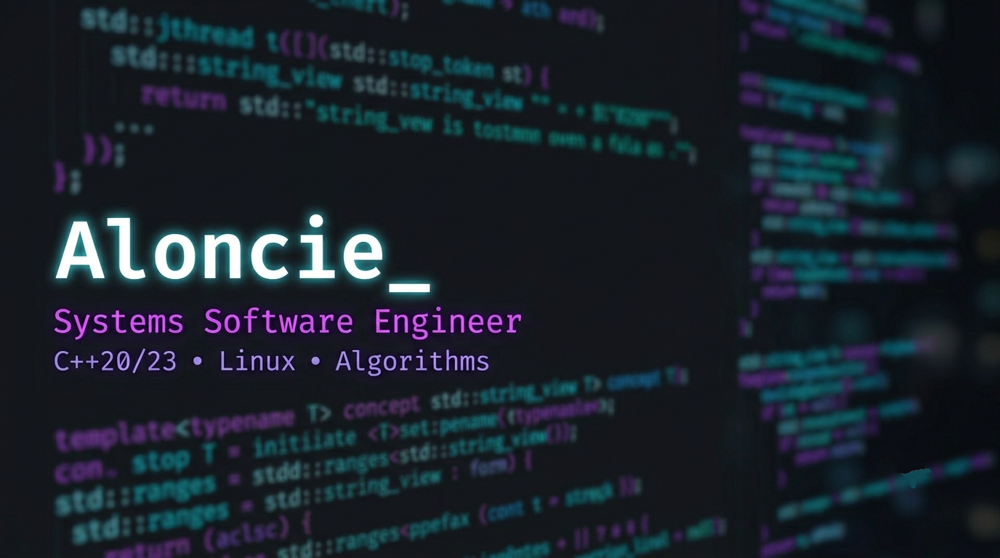

  
# Hi, I'm Bogdan (Aloncie) 👋

**C++ developer (C++20, Linux) · systems programming · algorithms**

High-school student (physics-math class), open to part-time remote C++ roles.

I write systems software in modern C++ on Linux, and I care about code that is predictable, cheap to run and easy to reason about.

  
<h2><b>My stack📚</b></h2>

  

## 🚀 Featured Project: [Rwal](https://github.com/Aloncie/Rwal)

*A cross‑platform wallpaper manager that automatically downloads fresh wallpapers from Wallhaven based on your configuration and applies them on Linux (GNOME, KDE, Hyprland) or Windows.*

**Status:** v0.7.2-beta, development paused (school and olympiads). Built solo over about a year, 620+ commits.

- **Architecture:** Strict interface boundaries (`IWallpaperSetter`, `IFileSystem`) decouple business logic from OS‑specific APIs. A single binary adapts at runtime to the current desktop environment (no recompilation), and optional dependencies like `libgio-2.0` are loaded dynamically via `dlopen` so that non‑GNOME users never pay for unused libraries.
- **Removed Qt:** users shouldn't have to install a huge framework for a small utility, so I replaced Qt with plain C++20/STL and native APIs (D-Bus, Win32/COM, Unix sockets). Binary size and CPU usage stayed about the same (TUI at 0.1–0.4% CPU), but the heavy dependency is gone.
- **Interactive TUI:** Custom ncurses‑based interface with a state‑machine Navigator pattern, asynchronous wallpaper refresh, and real‑time keyword editing through the system `$EDITOR`.
- **Testing & CI:** Unit and integration tests written with GoogleTest + GoogleMock. GitHub Actions builds and packages the project into `.deb`, `.rpm`, `.tar.gz` and `.zip`, delivering ready‑to‑use binaries on every release.
- **System Integration:** systemd timers for background rotation, hot‑reload of configuration, and an offline mode that picks a random wallpaper from your saved collection when the network is unavailable.

**Stack:** C++20, CMake, Linux API, Win32 API, D‑Bus, libcurl, ncurses, GSettings, GoogleTest & GoogleMock, Docker.

## **🖥️ Infrastructure Project: Self-Hosted Debian Home Server**

*A 24/7 headless Debian Linux server providing local infrastructure, network-level security, and automated media distribution in a resource-constrained environment.*

📺 [Video walkthrough](https://youtu.be/I3JlJ0OKSJ8) · [Configs & Docker Compose](https://github.com/Aloncie/Server)

- **OS Administration:** Configured a lightweight headless Debian environment: BBR and IP forwarding tuning, Docker Engine, v2rayA/Xray on the host, lid-switch handling for a laptop-as-server, and containers running as a non-root user (PUID/PGID 1000).
- **Container Orchestration:** Runs AdGuard Home (host network for DNS), Jellyfin and qBittorrent as separate Docker Compose stacks with a shared media volume, hardware transcoding through `/dev/dri` and direct play to keep CPU load low, and the qBittorrent WebUI bound to a LAN address only.
- **Network & Service Automation:** Deployed DNS-level filtering via AdGuard Home for tracker/ad blocking across local network devices, configured a local proxy, and set up continuous 24/7 torrent seeding and media delivery.

**Stack:** Debian Linux, Docker, Docker Compose, systemd, Bash, AdGuard Home, Jellyfin, qBittorrent, Networking (DNS, TCP/IP, Port Forwarding).

## 📚 Education
High school, physics-math class; olympiads in mathematics and informatics.

## 🧮 Algorithms & Problem Solving
- **Competitive Programming:** I regularly solve [Codeforces](https://codeforces.com/profile/Aloncie) problems up to ~1500 difficulty and practice on [LeetCode](https://leetcode.com/Aloncie/).

## 🛠 Tools & Knowledge Management
- **Environment:** Arch Linux, Neovim, Zsh.
- **Databases & Infrastructure:** PostgreSQL (schema design, migrations), MySQL, Docker & Docker Compose, Debian Linux (self-hosted 24/7 server).
- **Build & CI/CD:** CMake, Git (Conventional Commits), Docker (Multi-stage builds), GoogleTest & GoogleMock.

## 🎯 Next
Learning backend development in C++ (Drogon, PostgreSQL) and going deeper into multithreaded C++.

---

📫 **Contact & Connect:**
- [LinkedIn](https://www.linkedin.com/in/aloncie) 
- [YouTube](https://www.youtube.com/@Aloncie)
- [Email](mailto:Aloncie@proton.me)
- [Telegram](https://t.me/Aloncie)
